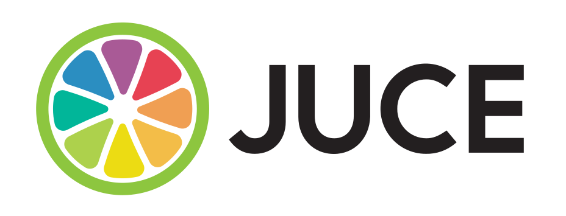
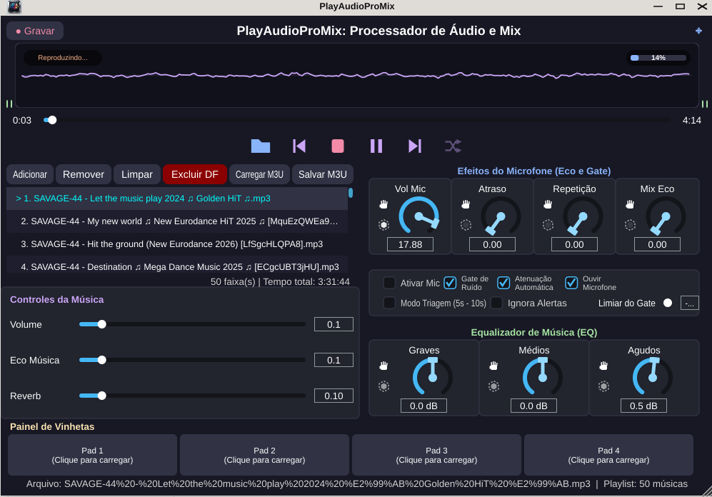
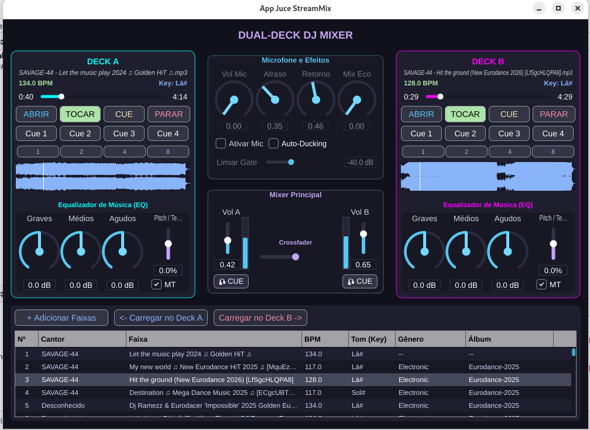
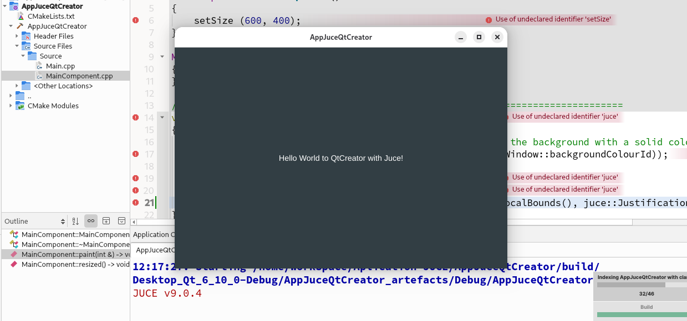

Excelente! As interfaces das suas aplicações ficaram ótimas e mostram recursos muito avançados de processamento de áudio digital (DSP), mixagem e gerenciamento de playlists.
Aqui está o arquivo README.md completo e atualizado. Integrei os seus dois softwares na seção de portfólio (🛠️ Aplicações Desenvolvidas), detalhando as funcionalidades técnicas exatas presentes em cada um pelas imagens (como o mixer de dois decks, controles de eco/reverb, gate de ruído e equalizadores de 3 bandas).
markdown
# AppJuceQtCreator
Just an Application to show how to use QtCreator with JUCE Framework...



# 🚀 Explorando o Framework JUCE: Do Desktop ao Android

Bem-vindo ao guia prático sobre o **JUCE**, o framework em C++ mais utilizado no mundo para o desenvolvimento de aplicações e plugins de áudio de alta performance. 

Este repositório serve como um ponto de partida para iniciantes, cobrindo desde o conceito básico até a estruturação de um projeto utilizando boas práticas modernas de desenvolvimento.

---

## 🌟 O que é o Framework JUCE?

O **JUCE (Guided Hand-Shed Software)** é um framework cross-platform especializado em áudio digital e interfaces gráficas (GUI). Com ele, você escreve o código uma única vez em C++ e o exporta para Windows, macOS, Linux, iOS e Android.

### O que você pode construir com ele?
* 🎛️ **Plugins de Áudio:** Crie seus próprios efeitos (Delay, Reverb, Distorção) ou Instrumentos Virtuais (Sintetizadores) nos formatos mais populares do mercado: VST3, AU, AAX e CLAP.
* 📈 **Aplicações Gráficas Avançadas:** Crie softwares standalone de áudio (como DAWs simplificadas ou reprodutores de mídia) com renderização gráfica 2D/3D acelerada por hardware.
* 🎮 **Áudio para Jogos:** Desenvolva sistemas de áudio interativos e dinâmicos para engines ou middlewares de jogos.
* 📱 **Aplicações Mobile:** Leve suas ferramentas de produção musical e sintetizadores direto para a tela de smartphones e tablets.

---

## 🛠️ Aplicações Desenvolvidas (Portfólio)

Aqui estão dois softwares reais de processamento e mixagem que desenvolvi utilizando C++ e o ecossistema JUCE:

### 1. PlayAudioProMix: Processador de Áudio e Mix
Um reprodutor de áudio completo com rack de efeitos em tempo real voltado para transmissões ou reprodução ao vivo.
* **Mecanismo de Playback:** Gerenciamento avançado de playlists (formatos M3U), painel rápido para disparo de vinhetas (Instant Pads) e controles dedicados de ganho, eco e reverb espacial para as faixas.
* **Processamento de Microfone:** Processamento em tempo real da entrada de voz contendo controles analógicos virtuais para volume, atraso (delay), repetição e mixagem do eco. Inclui recursos essenciais de transmissão como **Noise Gate** (limiar ajustável) e **Atenuação Automática** (Ducking) da música ao falar.
* **Equalização:** Equalizador paramétrico integrado de 3 bandas (Graves, Médios e Agudos) para ajuste fino das faixas de frequência da música.



### 2. App Juce StreamMix: Dual-Deck DJ Mixer
Uma aplicação avançada inspirada nos softwares profissionais de DJ, focada em mixagem simultânea, análise de faixas e streaming.
* **Dual-Deck Player:** Dois decks independentes (Deck A e Deck B) com controle de waveform em tempo real, botões clássicos de transporte (Abrir, Tocar, Cue, Parar), pontos de marcação rápidos (Cue 1 a Cue 4) e loops temporizados (1, 2, 4 e 8 compassos).
* **DJ Mixer Central:** Mixer de canais com faders horizontais de volume independentes e controle deslizante de **Crossfader** para transições suaves entre os decks, além do sistema de monitoramento pré-escuta (Botão CUE).
* **Análise de Áudio Avançada:** Banco de dados de faixas integrado capaz de fazer a leitura e exibição automática de metadados como Cantor, Faixa, Gênero, Álbum, além da detecção em tempo real de **BPM (Beats Per Minute)** e **Tom Musical (Key)** com suporte a preservação de pitch (Master Transport - MT).
* **Efeitos Globais:** Equalizadores de 3 bandas individuais por deck e módulo de efeitos dedicado para microfones com suporte a Auto-Ducking automático para transmissões profissionais.



---

## 1. Como Instalar o JUCE (Passo a Passo)

### 🐧 No Linux (Ubuntu/Debian)
Para compilar projetos JUCE no Linux, precisamos instalar as dependências de áudio (ALSA, JACK) e desenvolvimento gráfico.

1. **Atualize o sistema e instale as dependências essenciais:**
   ```bash
   sudo apt update
   sudo apt install build-essential cmake git libasound2-dev libjack-jackd2-dev ladspa-sdk-dev libcurl4-openssl-dev libfreetype6-dev libx11-dev libxext-dev libxinerama-dev libxrandr-dev libxcursor-dev libwebkit2gtk-4.0-dev libglu1-mesa-dev
   ```
2. **Clone o repositório oficial do JUCE:**
   ```bash
   git clone --branch 9.0.4 https://github.com 
   ```

### 🪟 No Windows
1. **Instale o Visual Studio:** Baixe o [Visual Studio Community](https://microsoft.com) e, durante a instalação, selecione a carga de trabalho **"Desenvolvimento para desktop com C++"**.
2. **Instale o CMake:** Baixe e instale o [CMake oficial](https://cmake.org), certificando-se de adicioná-lo ao PATH do sistema durante a instalação.
3. **Instale o Git:** Instale o [Git para Windows](https://git-scm.com).
4. **Clone o JUCE:** Abra o Prompt de Comando ou PowerShell e execute:
   ```cmd
   git clone --branch master https://github.com C:\JUCE
   ```

---

## 2. Criando sua Primeira Aplicação no Qt Creator

Para quem já tem instalado basta dar sequencia no processo de criação do scrip do cmake e testar a aplicação de exemplo.

Para quem ainda não tem instalado e usa linux pode instalar a versão da comunidade atraves dos pacotes de instalação do sistema, ou pode baixar a ultima versão do site official do qt.

Baixando o Qt6, para Linux, Windows ou MacOS: https://qt.io

Se preferir compile sua propria versão baixando o código do github para versão v20.0.2: https://github.com

As instruções de compilação estão na página.

Embora o JUCE possua uma ferramenta própria chamada *Projucer*, a indústria utiliza predominantemente o **CMake** para gerenciar projetos modernos de médio e grande porte. O **Qt Creator** oferece um suporte nativo fantástico para CMake.



Duvidas: Peça ajuda para IA (DeepSeek, Claude, ChatGPT ou Gemini).

> *⚠️ **Atenção:** Apesar de estarmos usando a IDE Qt Creator, não usaremos as bibliotecas do Qt. Usaremos apenas a interface gráfica e o compilador da IDE para desenvolver em JUCE nativo.*

### Estrutura de Arquivos do Projeto
Crie uma pasta para o seu projeto com a seguinte estrutura básica:
```text
MeuProjetoJUCE/
├── CMakeLists.txt
└── Main.cpp
```

### 📄 Código do `CMakeLists.txt` para compilar uma aplicação feita em JUCE

Substitua o conteúdo do arquivo de configuração pelo script moderno abaixo. *(Ajuste o caminho do JUCE conforme sua instalação).*

```cmake
cmake_minimum_required(VERSION 3.15)
project(MinhaAppJUCE VERSION 1.0.0 LANGUAGES CXX)

# Define a versão do C++ requerida pelo JUCE
set(CMAKE_CXX_STANDARD 17)
set(CMAKE_CXX_STANDARD_REQUIRED ON)

# Altere o caminho abaixo para onde você clonou o JUCE na sua máquina
if(CMAKE_HOST_SYSTEM_NAME STREQUAL "Windows")
    add_subdirectory("C:/JUCE" juce_cmake_helper)
else()
    add_subdirectory("$ENV{HOME}/JUCE" juce_cmake_helper)
endif()

# Cria uma aplicação com interface gráfica (GUI)
juce_add_gui_app(MinhaAppJUCE)

# Adiciona o arquivo de código fonte
target_sources(MinhaAppJUCE PRIVATE Main.cpp)

# Organiza os módulos e vincula as dependências fundamentais de áudio e interface
target_link_libraries(MinhaAppJUCE PRIVATE
    juce::juce_audio_basics
    juce::juce_graphics
    juce::juce_gui_basics
)

# Habilita formatos de arquivo comuns e recursos básicos
target_compile_definitions(MinhaAppJUCE PRIVATE
    JUCE_WEB_BROWSER=0
    JUCE_USE_CURL=0
)
```

### 📄 Código de Teste do `Main.cpp`
Este é um template limpo seguindo as diretrizes modernas de arquitetura do JUCE. Ele cria uma janela nativa centralizada que exibe uma mensagem na tela.

```cpp
#include <JuceHeader.h>

//==============================================================================
class MainComponent  : public juce::Component
{
public:
    MainComponent()
    {
        setSize (400, 300);
    }

    ~MainComponent() override = default;

    void paint (juce::Graphics& g) override
    {
        // Define o fundo com uma cor escura elegante (Boas práticas de UI de áudio)
        g.fillAll (juce::Colours::black);

        // Configura a fonte e renderiza o texto centralizado
        g.setFont (juce::FontOptions (24.0f, juce::FontOptions::FontStyleFlags::bold));
        g.setColour (juce::Colours::cyan);
        g.drawText ("Olá, JUCE + Qt Creator!", getLocalBounds(), juce::Justification::centred, true);
    }

    void resized() override {}

private:
    JUCE_DECLARE_NON_COPYABLE_WITH_LEAK_DETECTOR (MainComponent)
};

//==============================================================================
class MainWindow    : public juce::DocumentWindow
{
public:
    MainWindow (juce::String name)
        : DocumentWindow (name,
                          juce::Desktop::getInstance().getDefaultLookAndFeel()
                                                      .findColour (juce::ResizableWindow::backgroundColourId),
                          DocumentWindow::allButtons)
    {
        setUsingNativeTitleBar (true);
        setContentOwned (new MainComponent(), true);

       #if JUCE_IOS || JUCE_ANDROID
        setFullScreen (true);
       #else
        setResizable (true, true);
        centreWithSize (getWidth(), getHeight());
       #endif

        setVisible (true);
    }

    void closeButtonPressed() override
    {
        juce::JUCEApplication::getInstance()->systemRequestedQuit();
    }

private:
    JUCE_DECLARE_NON_COPYABLE_WITH_LEAK_DETECTOR (MainWindow)
};

//==============================================================================
Use o código com cuidado.
class MinhaAppJUCEApplication  : public juce::JUCEApplication
{
public:
MinhaAppJUCEApplication() = default;
const juce::String getApplicationName() override       { return "MinhaAppJUCE"; }
const juce::String getApplicationVersion() override    { return "1.0.0"; }
bool moreThanOneInstanceAllowed() override             { return true; }
void initialise (const juce::String& commandLine) override
{
mainWindow.reset (new MainWindow (getApplicationName()));
}
void shutdown() override
{
mainWindow.reset();
}
void systemRequestedQuit() override
{
quit();
}
void anotherInstanceStarted (const juce::String& commandLine) override {}
};
//==============================================================================
START_JUCE_APPLICATION (MinhaAppJUCEApplication)
```

## 🏁 Resultado Final

Após configurar o CMake e compilar o código no Qt Creator, a janela abaixo deverá ser exibida com sucesso:


